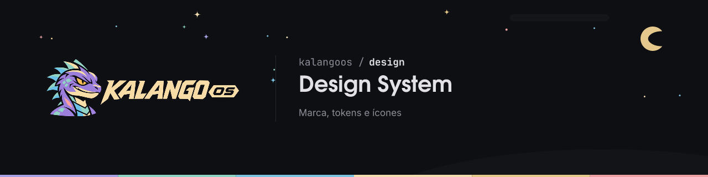
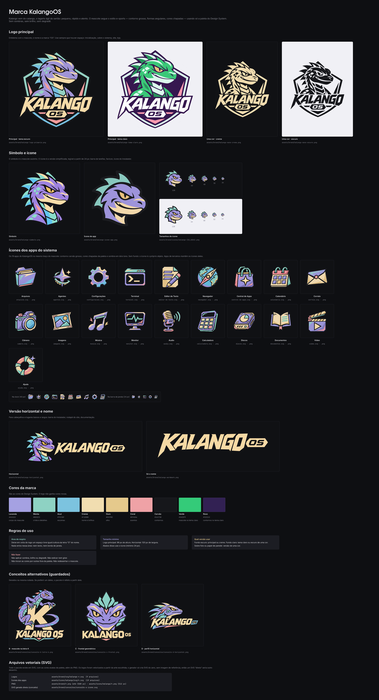

  

# Design System do KalangoOS

O que o [KalangoOS](https://github.com/kalangoos/kalangoos) usa para ter uma só linguagem visual: os tokens de cor,
movimento e medidas, a marca e os ícones dos apps do sistema. O arquivo-fonte do Design System (FigCraft) não é
publicado; tudo aqui é exportado dele.

| Pasta | O quê |
|---|---|
| `tokens/` | `tokens-dark.css` e `tokens-light.css` (cores como `@define-color` do GTK, nos temas escuro e claro) e `tokens.json` (as coleções Cores, Layout e Motion: cores, raios, espaços e molas) |
| `marca/` | Logo principal, símbolo, ícone, versão horizontal, nome, versões de uma cor e do tema claro, em PNG (até 3100 px), `1024/`, `icones/` (32–1024 px) e `svg/`; `conceitos/` guarda as alternativas que não foram escolhidas |
| `icones/` | Os 19 ícones dos apps do sistema (Arquivos, Agentes, Configurações, Terminal…) em PNG 512, `128/` e `svg/`; `fonte/` tem as imagens originais |
| `guia/marca.png` | A página "Marca" do Design System: cores, tamanhos e regras de uso |

## Regras da marca

- **Cores** só da paleta: Lavanda `#A5A1E2`, Menta `#8ED2C3`, Azul `#7CC3DF`, Creme `#F1DDB0`, Ouro `#E5C98C`,
  Coral `#EFA2A6`, Carvão `#16171B`; no tema claro, Verde `#34CB79` e Roxo `#322153`.
- **Sem sombra, brilho ou degradê.** Não esticar, não girar, não redesenhar o mascote.
- **Área de respiro** igual à altura da letra "O" do nome. **Tamanho mínimo:** logo principal com 96 px de altura,
  horizontal com 120 px de largura; abaixo disso, o ícone (mínimo 24 px).
- **Fundo escuro:** logo principal ou creme. **Fundo claro:** tema claro ou a versão escura de uma cor.

Fontes do Design System (não incluídas): Inter (texto), URW Gothic (títulos) e JetBrains Mono (código).

## Licenças

- `tokens/`: **GPL-3.0-or-later** ([LICENSE](LICENSE)), como o código do KalangoOS, que os embute.
- `marca/`, `icones/` e `guia/`: a **marca do KalangoOS**, fora de licença aberta ([LICENSE-brand.txt](LICENSE-brand.txt)).

A marca e os ícones foram gerados com IA (Higgsfield, modelo GPT Image) a partir de descrições escritas pelo projeto,
em novembro de 2026, e vetorizados (`vtracer`). Detalhes em [ATTRIBUTION.md](ATTRIBUTION.md).

---

**English.** KalangoOS's design tokens (GTK CSS colours for dark and light themes, plus colour, layout and spring
tokens as JSON; GPL-3.0-or-later), the brand pack and the 19 system app icons (the KalangoOS brand, not under an
open licence: see LICENSE-brand.txt). The FigCraft source file is not published.
